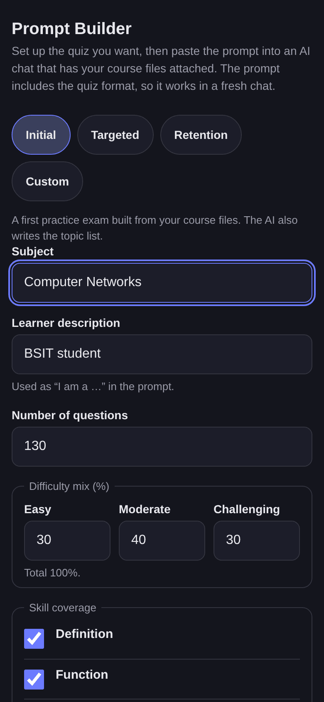
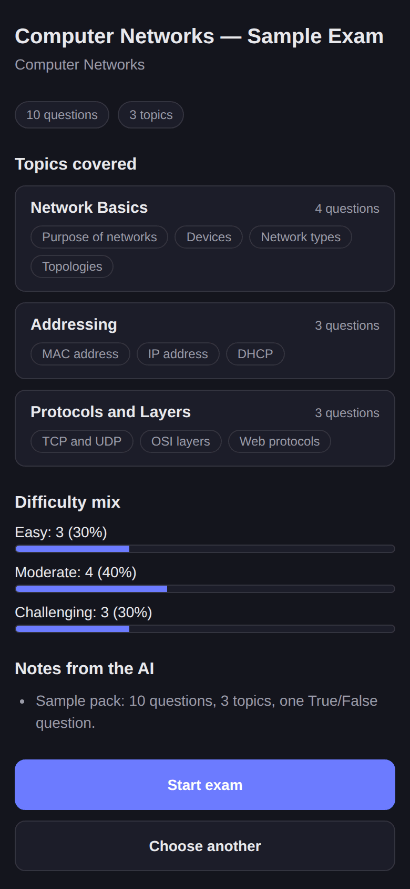
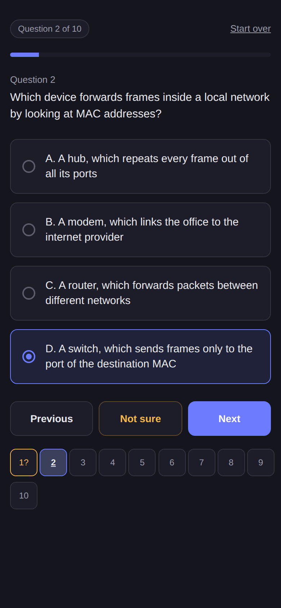
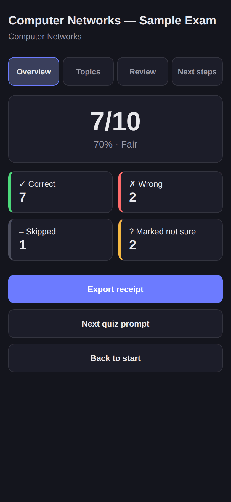
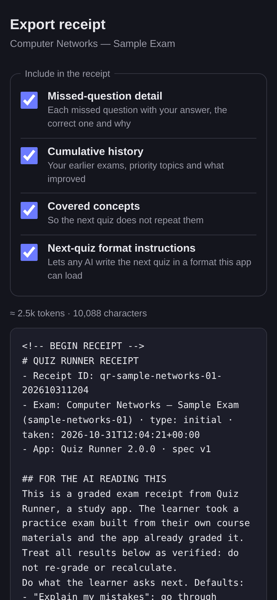

# Quiz Runner

Static, mobile-first practice-exam app: ask an AI to write a quiz from your own course files, take it here, get graded, and use the receipt to make the next quiz.
No build step, no backend, no accounts, no dependencies. Everything stays in your browser. Plan and rules: [`AGENTS.md`](AGENTS.md), [`docs/PLAN.md`](docs/PLAN.md).

## How to use the loop (6 steps)

The loop: **Prompt Builder → AI chat → Quiz Pack → Exam → Results → Receipt → next prompt.** The screenshots use `samples/sample-pack.json`.

### 1. Build the prompt

On the start screen tap **Prompt Builder**. Type the **subject**, pick a **mode** and check the options. **Initial** is the first exam (130 questions by default) and also asks the AI for a topic list; **Targeted** (40) and **Retention** (12) use a receipt; **Custom** takes your own task. Choose **One file or code block**, or **Split into parts** if 130 questions with explanations might be cut off. Tap **Copy** (or **Download .md**). The prompt already contains the quiz format, so it works in a fresh chat.



### 2. Give it to an AI

Open a **new** Claude or ChatGPT chat, **attach your own course files**, paste the prompt and send. The app never contains your course content and never talks to an AI. Don't edit the reply: save the file the AI gives you, or copy its single code block.

### 3. Load the quiz and check the topics

Back on the start screen, **paste** the reply, tap **Choose a file…**, or drop a `.json`, `.txt` or `.md` file, then tap **Load Questions**. The **Topics covered** screen shows the title, topics, question count, difficulty mix and the AI's notes. If the reply was cut off, the app says how many questions it kept ("Loaded 97 of 130") and offers a **Continue prompt** to paste into the same chat; load the new part and it is merged in. If the pack has errors, you get a list by question number and a **Repair prompt**. Tap **Start exam**.



### 4. Take the exam

Choose an answer, then **Next**. **Not sure** with nothing selected moves on; with an answer selected it keeps the answer and flags it. Jump to any question from the grid. On a desktop keyboard, A–D choose, N is next, P is previous and U is not sure. Your progress is saved on every change, so a refresh resumes the exam. Answers are not in the page during the exam. **Finish** shows how many questions are unanswered or unsure before you confirm.



### 5. Read your results

**Results** has four tabs: **Overview** (score, rating, counts), **Topics** (strong, developing, watch and weak topics; one miss never makes a topic weak), **Review** (every question with your answer, the correct one and the explanation, filtered by Wrong, Unsure, Skipped or All) and **Next steps** (what to study and what to take next). Finished exams are listed under **Progress**, with trends and priority topics.



### 6. Export the receipt and start the next round

Tap **Export receipt**, choose what to include, then **Copy**, **Download .md** or **Download .json**. Paste the receipt into any AI chat to have your mistakes explained or a study plan made: it carries its own instructions. For the next quiz, tap **Next quiz prompt** (on Results or on the receipt screen): the Prompt Builder opens in **Targeted** mode with the receipt already loaded. In the Prompt Builder you can also use **Use latest from this device**; for a **Retention** check that draws on every topic in your history, use **Retention check prompt** on the Progress screen. Then repeat from step 2.



Plain-text questions (numbered questions with `A.`–`D.`) still work: they open in the older **Quick Paste** mode, which exports your answers as a list like `1. B`.

Back up your history now and then from **Progress → Download backup**: if the browser clears its data, a backup restores it.

## Run locally

ES modules do **not** run from `file://` (double-clicking `index.html` shows a warning instead of the app).
Serve the folder over HTTP:

```bash
npx serve .          # or: npm start
```

Then open the address it prints (usually http://localhost:3000). Developed and tested on Node 22.

## Test

```bash
npm test             # runs: node --test
```

The pure modules in `js/` (everything except `main.js` and `ui/`) are tested without a browser.
Note: `node --test tests/` (a directory argument) fails on Node 22; use `node --test` or `npm test`.

## Layout

```
index.html           markup only
css/styles.css       all styles (design tokens at the top)
js/main.js           bootstrap + screen switching
js/router.js         hash router so the phone's back button works
js/constants.js      versions, thresholds, rating bands, storage keys (the only place for them)
js/store.js          localStorage wrapper: "qr:v1:" keys, try/catch everywhere, in-memory fallback
js/loader.js         tolerant JSON loader, truncation salvage, legacy text parser
js/validator.js      pack validation (errors and warnings)
js/parts.js          missing questions, multi-part merge
js/exam.js           exam model, "Not sure" rule, keyboard shortcuts
js/grader.js         pack + responses -> result
js/analytics.js      topic status, rating, next-exam allocation
js/receipt.js        receipt Markdown/JSON, receipt import, legacy "1. B" export
js/promptBuilder.js  options -> prompt text
js/history.js, progress.js, backup.js, session.js, settings.js, storagehealth.js   saved data
js/ui/               DOM-only screen code
samples/             good and deliberately broken packs, a sample receipt (see samples/README.md)
tests/               node:test suites
docs/                PLAN, DEV_CHECKLIST, QA_LOG, img/ (README screenshots), ai/ specs (Quiz Pack, Receipt, Prompt templates)
```

## Release and rollback

The app version is `APP_VERSION` in `js/constants.js`; keep `version` in `package.json` the same. The sample receipt and the prompt snapshots in `tests/snapshots/` contain it, so after a bump run `UPDATE_SNAPSHOTS=1 node --test tests/prompt-snapshots.test.js`, update the two version lines in `samples/sample-receipt.md`, and review the diff.

The pre-v2 app is meant to be tagged `v1-legacy` (checklist P0-04). **Check that the tag exists before you ship v2:**

```bash
git tag -l v1-legacy
git ls-remote --tags origin v1-legacy
```

If it is missing, tag the last commit made before `index.html` was split into `css/` and `js/` (P1-01), then push the tag: `git tag v1-legacy <commit>` and `git push origin v1-legacy`.

Vercel builds from branch pushes; it does not deploy a bare tag. To go back to the old app:

1. **Fastest, right after v2 went live:** in the Vercel dashboard use **Instant Rollback** (or `vercel rollback`). It restores the previous *production* deployment, which is the old app only if nothing else was promoted since, and on the Hobby plan only the immediately previous deployment can be chosen.
2. **From the tag (works at any time):** `git push origin 'v1-legacy^{commit}:refs/heads/rollback-v1'` (the `^{commit}` part is needed when the tag is annotated; the plain form is rejected). Vercel builds a preview for that branch. Open it, check it, then **Promote to Production** in the dashboard (or `vercel promote <preview-url>`). Delete the `rollback-v1` branch afterwards.
3. **Without Git:** `git checkout v1-legacy` and run `vercel --prod` from that checkout.

Your saved exams stay in the browser while the old app is live; the old app doesn't read them, and v2 finds them again when you go forward.
